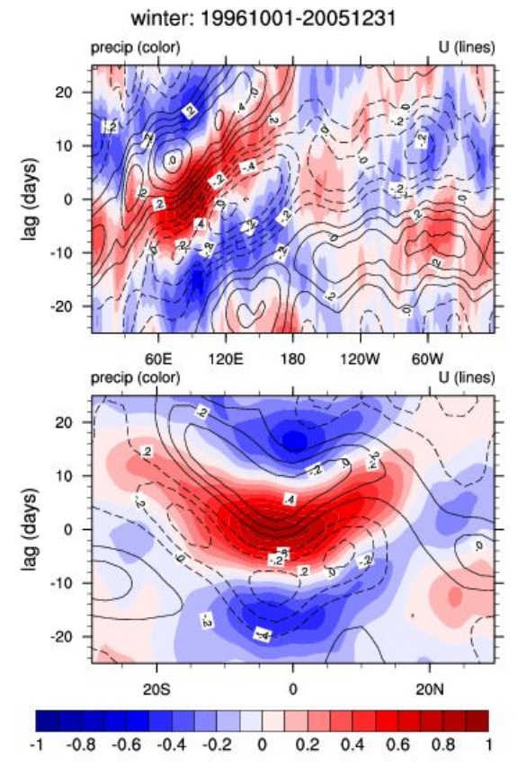
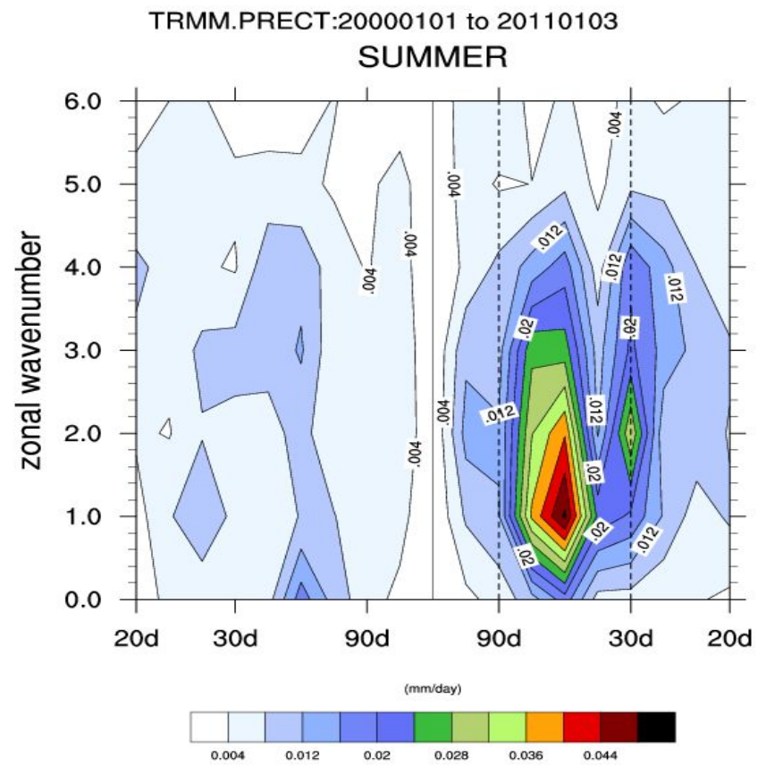
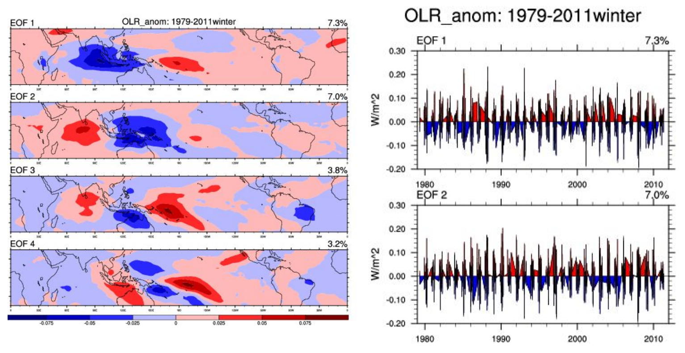
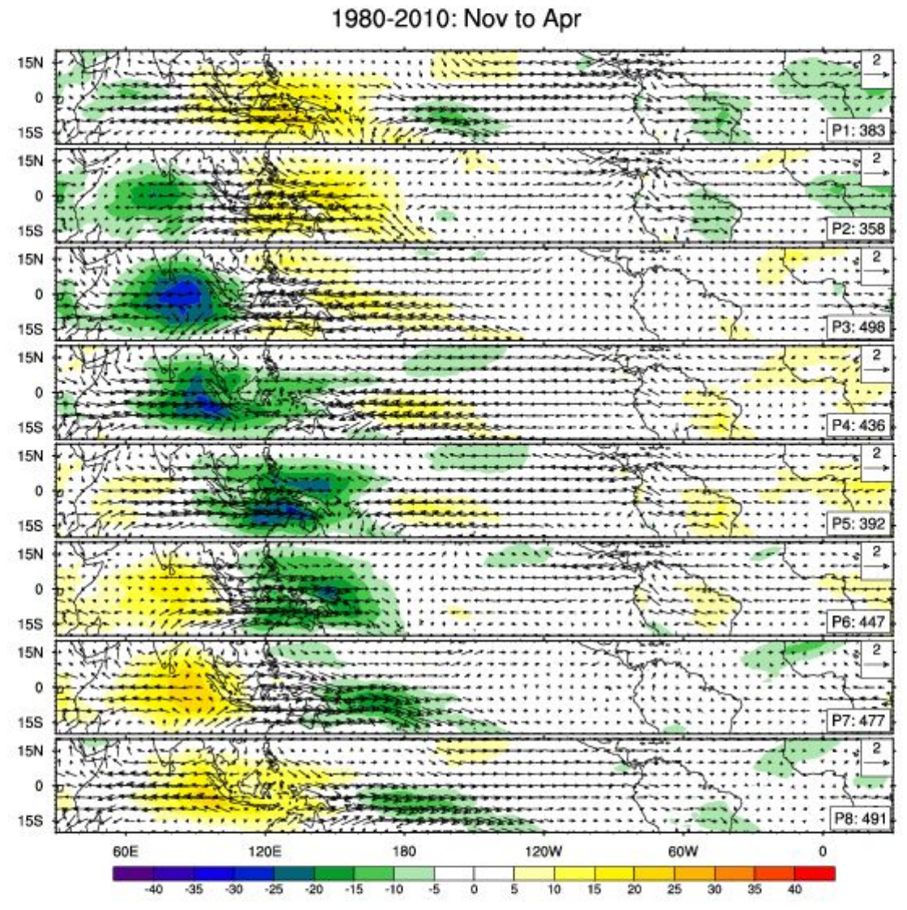

MJO Suite Diagnostic Module From NCAR
=====================================
Last update: 11/12/2026

This module computes many of the diagnostics described by the the ​US-CLIVAR Madden-Julian Oscillation (MJO) working group​ and developed by NCAR’s ​Dennis Shea for observational data​. Using daily precipitation, outgoing longwave radiation, zonal and meridional wind at 850 and 200 hPa, the module computes anomalies, bandpass-filters for the 20-100 day period, calculates the MJO Index as defined as the running variance over the bandpass filtered data, performs an EOF analysis, and calculates lag cross-correlations, wave-number frequency spectra and composite life cycles of MJO events.

Contact info
------------

- PI: Rich Neale, NCAR
- Current Developer: Dani Coleman (​bundy@ucar.edu​), NCAR
- Contributors: Dennis Shea, Andrew Gettleman, Jack Chen (NCAR)

Open source copyright agreement
^^^^^^^^^^^^^^^^^^^^^^^^^^^^^^^

This package is distributed under the LGPLv3 license (see LICENSE.txt).

Functionality
-------------

All scripts can be found at: ``mdtf/MDTF_$ver/var_code/MJO_suite``

1. Read in daily model output: daily_netcdf.ncl
2. Computes daily anomalies: daily_anom.ncl
3. Calculates EOFs: mjo_EOF.ncl
4. Creates​ ​MJO lag plots: mjo_lag_lat_lon.ncl
5. Calculates MJO spectra: mjo_spectra.ncl
6. Calculates principle component from EOF analysis: mjo_EOF_cal.ncl
7. MJO life cycle composite: mjo_life_cycle_v2.ncl

| Observation figures (see "Observational data" below) are in ``mdtf/inputdata/obs_data/MJO_suite``.
| Place your input data at: ``mdtf/inputdata/model/$model_name/day``
| index.html can be found at: ``mdtf/MDTF_$ver/wkdir/MDTF_$model_name``

Required Programing Language and libraries
------------------------------------------

| All these scripts required NCAR Command Language Version 6.3.0 or higher
| The following Python packages are required: os, glob

Required input data to the module
---------------------------------

The following six lat-lon-time model fields are required as daily means (CESM names in parentheses)

1. Precipitation rate, pr (PRECT) (units: m/s; other units are converted by the framework)
2. Outgoing longwave radiation, rlut (FLUT) (units: W/m\ |^2|)
3. Zonal wind at 850 hPa, u850 (U850) (units: m/s)
4. Zonal wind at 200 hPa, u200 (U200) (units: m/s)
5. Meridional wind at 850 hPa, v850 (V850) (units: m/s)
6. Meridional wind at 200 hPa, v200 (V200) (units: m/s)

Missing values in the input data
--------------------------------

The band-pass filters, EOFs and spectra need a complete daily record. When each variable is read
(``read_model_file`` in ``utils.ncl``), missing values are filled by linear interpolation in time
at each grid point (NCL ``linmsg_n``): a run of missing days is filled with a straight line between
the valid days on either side, and missing days at the start or end of the record take the nearest
valid value. This is the same first step as in the Wheeler_Kiladis POD, and fills, for example, the
30 documented missing days of the NOAA daily OLR Climate Data Record (1980-1989). A point missing
at every time stays missing. The log reports how many values were filled, for example
``read_model_file: rlut: filled ... missing values by linear interpolation in time``.

Observational data
------------------

The observation panels in ``obs_data`` were made by running this POD on observations treated as a
model case, for 2001-2024 with IMERG precipitation. All observations are daily means on
one 1 x 1 deg grid (cell centres 89.5S-89.5N, 0.5-359.5E), the native grid of the NOAA daily OLR
Climate Data Record.

- **OLR**: NOAA Climate Data Record (CDR) of Daily Outgoing Longwave Radiation, version 2
  (v02r00), 1979-present (Lee 2025; https://doi.org/10.25921/9pt5-by77), produced at the
  University of Maryland ESSIC (http://olr.umd.edu). It is derived from HIRS radiances on the
  NOAA and MetOp polar orbiters, calibrated against broadband (ERBE/CERES) OLR, with
  geostationary data for the diurnal cycle. NOAA documents 30 days with no data, all between
  1980 and 1989 (1980-03-02, 03-03, 06-04; 1981-03-24 to 04-08; 1982-09-22, 23; 1983-08-03;
  1984-01-11, 12, 12-03; 1985-09-22, 23; 1986-03-12; 1989-02-19, 20). In the distributed file 4
  of them (1980-03-02/03, 1989-02-19/20) contain values; these were set to missing, so all 30
  days are missing in the obs file and are filled by the POD as described above.
- **Precipitation**:

  - 2001-2024 (the panels in ``obs_data``): NASA GPM IMERG Final Run V07B daily (Huffman et al.
    2023; https://doi.org/10.5067/GPM/IMERGDF/DAY/07), 0.1 deg, averaged (area-weighted) onto the 1
    deg grid.
  - 1998-2019 (alternative figure set): TRMM Multi-satellite Precipitation Analysis 3B42 V7 daily
    (Huffman et al. 2007; https://doi.org/10.5067/TRMM/TMPA/DAY/7), 0.25 deg, 50S-50N, averaged onto
    the 1 deg grid. Each TRMM day runs from 01:30 UTC to 01:30 UTC the next day; the record ends
    2019-12-30.
  - 1979-1999 (alternative figure set, before the satellite records): ERA5 mean total precipitation
    rate.

- **Winds**: ERA5 reanalysis (Hersbach et al. 2020), hourly 0.25 deg pressure-level analyses,
  averaged over the 24 hours of each UTC day and regridded conservatively to 1 deg. ERA5.1
  (Simmons et al. 2020) is used for 2000-2006, as ECMWF recommends.

The file names in ``obs_data`` give the source of each panel (CDR, IMERG or ERA5):
``<source>.<var>.<plot>.png``, e.g. ``CDR.rlut.EOF.winter-0.png``,
``IMERG.pr.MJO.wave.freq.summer.png`` and ``ERA5.MJO.png`` (MJO index); plots that combine fields
name both sources, e.g. ``IMERG_ERA5.MJO.lag.lat.lon.winter.png`` (precipitation with ERA5 u850) and
``CDR_ERA5.MJO.life.cycle.winter.png`` (OLR with ERA5 winds). A ``README.txt`` there lists the
sources. The ``obs_data`` directory is distributed as ``MJO_suite.20261119.tar`` in the MDTF
`Digested observational data (Globus)
<https://app.globus.org/file-manager?origin_id=87726236-cbdd-4a91-a904-7cc1c47f8912>`__ collection.

The daily observation files, the scripts that made them, and the alternative figure sets for
TRMM (1998-2019) and ERA5 precipitation (1979-1999) are available from:

- Globus collection ``620e84f2-1f5b-46b7-addd-06e9ba44cfac``, path ``/MDTF_WK_MJO_obs/``
  (`Globus link <https://app.globus.org/file-manager?origin_id=620e84f2-1f5b-46b7-addd-06e9ba44cfac&origin_path=%2FMDTF_WK_MJO_obs%2F>`__);
  ``instructions.txt`` there describes the files and how to run them through MDTF.
- https://project.cgd.ucar.edu/projects/MDTF/MDTF_WK_MJO_obs/ (figures and scripts, no data).

The previous observation panels (NCEP/NCAR reanalysis, ERA and TRMM, 2018) used several grids
and periods.

Observation references
^^^^^^^^^^^^^^^^^^^^^^

- Hersbach, H., and co-authors, 2020: The ERA5 global reanalysis. *Q. J. R. Meteorol. Soc.*,
  **146**, 1999-2049, https://doi.org/10.1002/qj.3803.
- Huffman, G. J., and co-authors, 2007: The TRMM Multisatellite Precipitation Analysis (TMPA).
  *J. Hydrometeor.*, **8**, 38-55, https://doi.org/10.1175/JHM560.1.
- Huffman, G. J., E. F. Stocker, D. T. Bolvin, E. J. Nelkin, and J. Tan, 2023: GPM IMERG Final
  Precipitation L3 1 day 0.1 degree x 0.1 degree V07. NASA GES DISC,
  https://doi.org/10.5067/GPM/IMERGDF/DAY/07.
- Lee, H.-T., 2025: Climate Algorithm Theoretical Basis Document (C-ATBD): Outgoing Longwave
  Radiation (OLR) - Daily. NOAA CDR Program, CDRP-ATBD-0526 Rev 2. Dataset:
  https://doi.org/10.25921/9pt5-by77.
- Simmons, A., and co-authors, 2020: Global stratospheric temperature bias and other stratospheric
  aspects of ERA5 and ERA5.1. ECMWF Technical Memorandum 859, https://doi.org/10.21957/rcxqfmg0.

References
----------

   .. _1:

1. MJO Simulation Diagnostics, Waliser et al, 2009, *J.Clim.*, **​22**:​ 3006-3030, https://doi.org/10.1175/2008JCLI2731.1

More About the Diagnostic
-------------------------

An extensive explanation of the figures and techniques used to achieve them can be found on Dennis Shea’s NCL MJO CLIVAR page​. Some examples are provided below:

**Lag Correlation**: Lag correlation diagram using on 20-100 day band-pass filtered daily data. The reference time series is the central Indian Ocean regional precipitation time series, which is correlated with precipitation and zonal wind anomalies in specified regions at different lags. Lag-longitude and lag-latitude plots of correlation values for different regions are shown. Color is for precipitation correlations while the lagged correlations for the zonal winds are the contours. These are analogous the Figures 5 and 6 in the reference article except they are for one season.

**Wavenumber-Frequency Spectra**: The wavenumber - frequency spectra for each season, with vertical reference lines indicating at for 30 and 80 days.

**EOF analysis (univariate)**: Conventional (covariance) univariate EOF analysis for 20-100 day band-pass filtered data of outgoing longwave radiation over 30S to 30N.

**Composite Life-cycles**: The first and second principle components of the EOF analysis are used to derive the appropriate MJO phase category. The size of the reference anomaly wind vector is in the upper right. The phase (eg P3, means "Phase 3") and the number of days used to create the composite are at the lower right.

.. |^2| replace:: \ :sup:`2`\ 
.. |^3| replace:: \ :sup:`3`\ 
.. |^-1| replace:: \ :sup:`-1`\ 
.. |^-2| replace:: \ :sup:`-2`\ 
.. |^-3| replace:: \ :sup:`-3`\ 