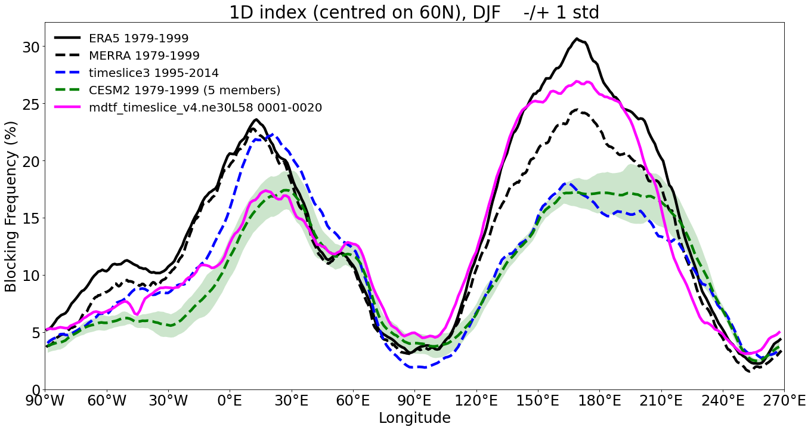
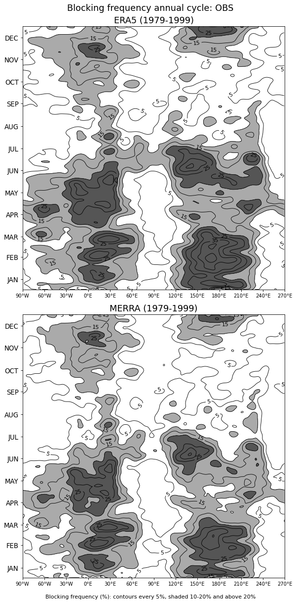
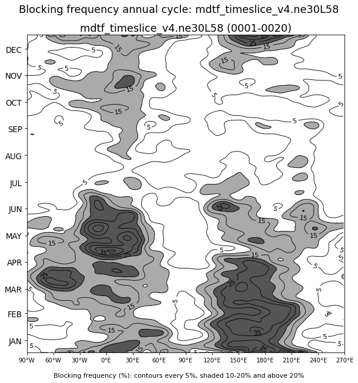
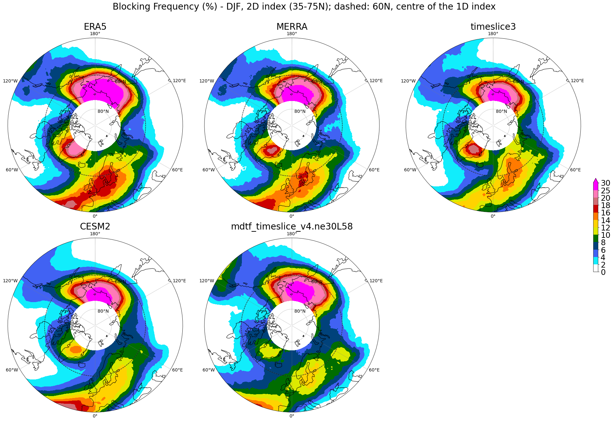

.. Format guides/tools:
   https://docutils.sourceforge.io/docs/user/rst/quickref.html
   https://sublime-and-sphinx-guide.readthedocs.io/en/latest/code_blocks.html
   Rendered MDTF diagnostics/*/doc/example.rst https://mdtf-diagnostics.readthedocs.io/en/latest/sphinx_pods/example.html)

Rich Neale's Blocking Diagnostic Documentation (notebook version)
=================================================================

Evaluates blocking frequency as determined by the meridional gradient above
a threshold value of daily 500mb height following
:ref:`D'Andrea et al (1998) <ref-DAndrea>` (a 1D index, a function of
longitude), and a 2D variant where the same test is applied over a band of
latitudes following :ref:`Davini et al (2012) <ref-Davini>`.

This POD (``blocking_neale_nb``) is a Python / Jupyter notebook version of the
NCL POD ``blocking_neale``. The notebook ``blocking_main.ipynb`` can be run by
the MDTF framework, or stand-alone (interactively in Jupyter or from the
command line). A stand-alone run writes the same output as a framework run:
the POD web page, figures, executed notebook, logs, a top-level ``index.html``
and (optionally) the tar file.

Example output (MDTF v4 timeslice case, DJF):
`blocking_neale_nb example <https://project.cgd.ucar.edu/projects/MDTF/mdtf_figures/blocking_neale_nb_project/index.html>`__
(`POD page <https://project.cgd.ucar.edu/projects/MDTF/mdtf_figures/blocking_neale_nb_project/blocking_neale_nb/blocking_neale_nb.html>`__,
`tar file <https://project.cgd.ucar.edu/projects/MDTF/mdtf_figures/blocking_neale_nb_project/MDTF_output.tar>`__).

Version & Contact info
----------------------
| Version 3.0 (Python notebook), MDTF v4
| PI: Rich Neale, NCAR, rneale@ucar.edu
| Contact: Dani Coleman, NCAR, bundy@ucar.edu

Open source copyright agreement
^^^^^^^^^^^^^^^^^^^^^^^^^^^^^^^
The MDTF framework is distributed under the LGPLv3 license (see LICENSE.txt)

Functionality
-------------

Required programming language and libraries
^^^^^^^^^^^^^^^^^^^^^^^^^^^^^^^^^^^^^^^^^^^

Python 3 with numpy, pandas, xarray, scipy, matplotlib, cartopy, intake-esm
and nbconvert. These are all in the standard MDTF ``_MDTF_python3_base``
conda environment. NCL is not needed.

Required model output variables
^^^^^^^^^^^^^^^^^^^^^^^^^^^^^^^

Daily geopotential height at 500 hPa (``zg``, or a 3D field with air pressure
levels, from which the framework extracts 500 hPa).

Comparison data
^^^^^^^^^^^^^^^

The MDTF case is the only data the POD reads (from the catalog, or the
framework's preprocessed file). The comparison data are shipped as digested
data: the blocking frequencies already computed for each reference dataset, in
the POD's obs data directory ``<OBS_DATA_ROOT>/blocking_neale_nb`` (a few MB of
netCDF files named as in `Blocking frequency files`_ below):

- Observations: ERA5 and MERRA, 1979-1999
- Model ensembles: CESM2 Large Ensemble, 5 members, 1979-1999; and
  ``timeslice3``, the MDTF v3 timeslice CESM run, 1995-2014 (one member)

These are the defaults of ``MDTF_BLOCKING_ENSEMBLES``,
``MDTF_BLOCKING_ENS_MEMBERS`` and the reference years. A different choice
(other years, members, seasons or datasets) is computed from the raw daily
Z500, read through an ESM-intake catalog given by
``MDTF_BLOCKING_RAW_CATALOG``. The raw data are on NCAR's GLADE file system.
Their locations are in one table, ``RAW_DATA`` in ``blocking_utils.py``, which
is used only to build that catalog:

``python blocking_utils.py --make-raw-catalog <catalog.json> [names...]``

(run in the POD directory on GLADE; it writes ``<catalog>.json`` and
``<catalog>.csv``, listing every file found). Datasets in the table:

==============  ===========  =========================================================
Name            Type         Status
==============  ===========  =========================================================
ERA5, MERRA     obs          tested; shipped
CESM2           model        tested; shipped (5 members); 50 members in the catalog
timeslice3      model        tested; shipped
ERAI            obs          untested with the current version
CESM1           model        untested with the current version (42 members)
E3SMv1          model        untested with the current version (5 members)
E3SMv2, EAMv2   model        untested with the current version (20, 10 members)
CAM6            model        untested; raw files not found on GLADE (Nov 2026)
==============  ===========  =========================================================

The shipped files were made by the same code: see `Making the digested data`_.

Settings/Environment Variables
------------------------------

POD settings (``settings.jsonc``)
^^^^^^^^^^^^^^^^^^^^^^^^^^^^^^^^^

Set in ``pod_env_vars`` in ``settings.jsonc``. The framework passes them to
the notebook as environment variables, so every value is a string and lists
are comma-separated.

==============================  ======================  ==============================================
Variable                        Default                 Meaning
==============================  ======================  ==============================================
``MDTF_BLOCKING_SEASON``        ``"DJF"``               Season for the seasonal line plot and maps:
                                                        DJF, MAM, JJA, SON or ANN
``MDTF_BLOCKING_HEMISPHERE``    ``"nhem"``              Hemisphere (only nhem is implemented)
``MDTF_BLOCKING_ENSEMBLES``     see below               Observations and model ensembles to compare
                                                        against the MDTF case(s)
``MDTF_BLOCKING_ENS_MEMBERS``   ``"1,1,1,5"``           Number of members to use from each entry in
                                                        ``MDTF_BLOCKING_ENSEMBLES`` (same order)
``MDTF_BLOCKING_REF_FIRSTYR``   see below               First year for the comparison data: one
                                                        year for all, or one per entry in
                                                        ``MDTF_BLOCKING_ENSEMBLES``.
                                                        Blank: use the case years
``MDTF_BLOCKING_REF_LASTYR``    see below               Last year for the comparison data (same
                                                        rules)
``MDTF_BLOCKING_RECOMPUTE``     ``"False"``             Recompute cached blocking frequencies:
                                                        "False", "True" (all) or dataset names,
                                                        e.g. "CESM2,ERA5"
``MDTF_BLOCKING_CACHE_DIR``     ``""``                  Where to keep blocking frequency files.
                                                        Blank: this run's ``model/netCDF``
``MDTF_BLOCKING_RAW_CATALOG``   ``""``                  ESM-intake catalog of the raw comparison
                                                        data, for results not in the cache or
                                                        ``$OBS_DATA``. Blank: shipped data only
==============================  ======================  ==============================================

The defaults select the shipped comparison data:
``MDTF_BLOCKING_ENSEMBLES = "ERA5,MERRA,timeslice3,CESM2"``,
``MDTF_BLOCKING_REF_FIRSTYR = "1979,1979,1995,1979"`` and
``MDTF_BLOCKING_REF_LASTYR = "1999,1999,2014,1999"``. The years are given per
dataset because the datasets cover different periods; one value applies to
all, and blank means the case years. The reference years do not have to
overlap the case years (a pre-industrial case with model years 0001-0020
works with the defaults).

``MDTF_BLOCKING_SEASON`` defaults to DJF, the season with the most blocking and
the one most often shown in the literature; ANN (all days) is also available.
The annual-cycle figures do not depend on it.

Run settings (``input_*.yml``)
^^^^^^^^^^^^^^^^^^^^^^^^^^^^^^

The usual MDTF runtime configuration: ``case_list`` (case name, convention,
``startdate``, ``enddate``), ``DATA_CATALOG``, ``OBS_DATA_ROOT``,
``WORK_DIR``, ``OUTPUT_DIR``, ``conda_root``, ``conda_env_root``,
``make_variab_tar``, ``overwrite``, etc. For a stand-alone run the case data
are read from ``DATA_CATALOG`` with intake-esm, using the same query as the
framework: the catalog path must contain the case name, and the variable is
matched on frequency, realm and standard name.

Settings in the notebook
^^^^^^^^^^^^^^^^^^^^^^^^

Near the top of the notebook are two text cells, written in the formats of
the two files above:

- ``runtime_yml``: the run settings, in ``input_*.yml`` format
- ``pod_settings_jsonc``: the POD settings, identical to ``settings.jsonc``

Edit these to change an interactive run. The export cell writes them out as
``input_<case>.yml`` and ``settings.jsonc`` (to the POD output directory) and
prints the commands to repeat the same run in batch. Where the settings come
from depends on how the notebook is run:

================================  =============================================
Run mode                          Settings source
================================  =============================================
Interactive (Jupyter)             The two text cells in the notebook
Stand-alone, command line         ``--config`` and ``--settings`` files
                                  (``MDTF_RUNTIME_CONFIG``, ``MDTF_POD_SETTINGS``)
MDTF framework (``mdtf -f``)      Environment variables set by the framework;
                                  the case data are the framework's
                                  preprocessed file (``MODEL_DATA_PATH``)
================================  =============================================

How to run
----------

1. MDTF framework: add ``blocking_neale_nb`` to ``pod_list`` and run

   ``./mdtf -f input_<case>.yml``

2. Stand-alone, command line (from the top of the MDTF-diagnostics repo, in an
   MDTF python3 conda env):

   ``python -m src.standalone_html run diagnostics/blocking_neale_nb/blocking_main.ipynb --config input_<case>.yml [--settings settings.jsonc] [--kernel <name>]``

   This executes the notebook with ``jupyter nbconvert``, saves it as
   ``blocking_main_ipynb.html`` in the POD output directory, and makes the tar
   file if ``make_variab_tar`` is True. It does not need the framework's conda
   setup or preprocessing.

3. Interactive: open ``blocking_main.ipynb`` in Jupyter with an MDTF python3
   kernel, edit the settings cells and run all cells. Save the notebook
   (Ctrl-S) before the last cell runs, or save and then re-run the last cell.
   That cell writes ``blocking_main_ipynb.html`` from the saved notebook
   (``standalone_html.export_saved_notebook``; nbconvert reads the file on
   disk, not the running kernel), then the web page and the tar file. If the
   notebook has not been saved since the run started it skips the html and
   says so. The html does not show the last cell's own output.

Output
^^^^^^

All three methods write the framework layout under
``<WORK_DIR>/MDTF_output`` (``MDTF_output.v1``, ``.v2``, ... if
``overwrite`` is False):

- ``index.html``, ``mdtf_diag_banner.png``, ``config_save.json``, logs
- ``blocking_neale_nb/blocking_neale_nb.html`` (the POD page)
- ``blocking_neale_nb/model/*.png``, ``blocking_neale_nb/obs/*.png`` (figures)
- ``blocking_neale_nb/model/netCDF/block_*.nc`` (blocking frequencies)
- ``blocking_neale_nb/blocking_main_ipynb.html`` (executed notebook)
- ``<WORK_DIR>/MDTF_output.tar`` if ``make_variab_tar`` is True

Blocking frequency files
^^^^^^^^^^^^^^^^^^^^^^^^

Each blocking frequency result (1D, 2D and annual cycle, for each dataset) is
saved as a netCDF file named by index, dataset, number of members, years and
season, for example ``block_1D_CESM2_nens.5_1979-1999_ANN.nc``. A later run that
needs the same result reads the file instead of recomputing it:

- Files are looked for first in ``MDTF_BLOCKING_CACHE_DIR`` (blank: this
  run's ``model/netCDF``), then in the POD's obs data directory
  (``$OBS_DATA``, read-only), which holds the shipped results. A dataset whose
  results are all found is never opened. New results are written to
  ``MDTF_BLOCKING_CACHE_DIR``; set it to a shared directory to reuse results
  across runs and cases. The files used are always copied to
  ``model/netCDF`` as well, so the output is complete.
- Each file records the version of the calculation
  (``BLOCKING_CALC_VERSION`` in ``blocking_utils.py``). Files from another
  version are recomputed automatically; increase the version whenever a code
  change alters the results.
- ``MDTF_BLOCKING_RECOMPUTE`` forces a recalculation: ``"True"`` for
  everything, or a comma-separated list of datasets (e.g. a case whose data
  were rewritten under the same name).

Making the digested data
^^^^^^^^^^^^^^^^^^^^^^^^

The shipped files are the notebook's own results. On GLADE, build the raw-data
catalog (above), then run the notebook with ``MDTF_BLOCKING_RAW_CATALOG`` set to
it, ``MDTF_BLOCKING_CACHE_DIR`` set to the new obs data directory and
``MDTF_BLOCKING_RECOMPUTE = "ERA5,MERRA,timeslice3,CESM2"``, once for each
season (DJF, MAM, JJA, SON, ANN; the annual cycle is written every time), then
copy the ``block_*`` files for those datasets to
``<OBS_DATA_ROOT>/blocking_neale_nb``. Increase ``BLOCKING_CALC_VERSION`` and
regenerate them whenever a code change alters the results.

Methodology
-----------

1D blocking index
^^^^^^^^^^^^^^^^^

Following :ref:`Tibaldi and Molteni (1990) <ref-Tibaldi-Molteni>` and
:ref:`D'Andrea et al (1998) <ref-DAndrea>`, at every longitude and day the
500mb height gradients are computed around the central latitude
phi0 = 60N, with phiN = 78.85N and phiS = 41.25N:

- GHGN = (Z500(phiN) - Z500(phi0)) / (phiN - phi0)
- GHGS = (Z500(phi0) - Z500(phiS)) / (phi0 - phiS)

The test is repeated with all three latitudes shifted by -3.75, 0 and +3.75
deg (the nearest grid latitudes are used). A longitude is blocked on a given
day if GHGS > 0 and GHGN < -5 m per deg latitude for any of the three shifts.
The latitudes used span 37.5N-82.6N, so Z500 is read over 20N-90N.

Blocking frequency is the fraction of days blocked: for the chosen season
(``MDTF_BLOCKING_SEASON``; ANN uses every day) in the line plot, and for each
day of the year in the annual cycle.

Blocking frequency maps (2D index)
^^^^^^^^^^^^^^^^^^^^^^^^^^^^^^^^^^

The POD also shows polar stereographic maps of Northern Hemisphere blocking
frequency for the chosen season, one panel for each MDTF case,
observational product and model ensemble (ensemble mean).

These use a 2D blocking index following :ref:`Davini et al. (2012) <ref-Davini>`.
Instead of testing the 500mb height gradients only around a fixed central
latitude band (the 1D index above), the test is applied at every grid
latitude phi0 between 35N and 75N, using the heights 15 deg to the north and
south (nearest grid latitudes):

- GHGN = (Z500(phi0+15) - Z500(phi0)) / 15
- GHGS = (Z500(phi0) - Z500(phi0-15)) / 15

A grid point is blocked on a given day when GHGS > 0 and GHGN < -5 m per
deg latitude (the same thresholds as the 1D index). The blocking frequency
is the fraction of days in the season that each point is blocked, so the maps
locate blocking in latitude as well as longitude.

Comparing the 1D and 2D indices
^^^^^^^^^^^^^^^^^^^^^^^^^^^^^^^

The line plot and the maps are not directly comparable:

- The 1D index tests the gradients around 60N only (the dashed circle on the
  maps). The 2D index tests every latitude from 35N to 75N. Where blocking
  occurs well north or south of 60N, the maps show it and the 1D index does
  not: near 180E in DJF the highest 2D frequencies (about 25-38%) are at
  65-75N, while at 60N the 2D frequency is 8-20%.
- At the same latitude, the 1D index is higher than the 2D index: a longitude
  is blocked if any of three tests (shifted by -3.75, 0 and +3.75 deg)
  passes, and its points are about 19 deg apart instead of 15.
- This 2D index is a simplified form of Davini et al.'s: it uses the 1D
  thresholds (GHGN < -5 m per deg) without their additional conditions, so
  frequencies near the edges of the band (35N, and especially 70-75N) are
  likely too high.

Ensembles
^^^^^^^^^

For a model ensemble the frequency is computed for each member. The line
plot shows the ensemble mean with the member range shaded, and the maps and
annual cycle show the ensemble mean.

Code Overview
-------------

- ``blocking_main.ipynb``: the driver notebook. Sections:

  1. Settings: the ``runtime_yml`` and ``pod_settings_jsonc`` text cells,
     ``standalone_html.load_run_settings`` (works out the run mode and the
     settings), and the export cell.
  2. Load model data: the framework's ``MODEL_DATA_PATH`` file in a framework
     run, otherwise ``standalone_html.open_catalog_var`` (intake-esm).
  3. Comparison data: ``blocking_utils.ens_setup`` builds the ``block_meta``
     table (one row per dataset: type obs/model/mdtf, number of members,
     years, run names, files); the MDTF case(s) are added as rows; then
     ``blocking_utils.EnsembleData`` opens a dataset's Z500 (with
     ``dataset_get``) only if one of its results is not already available.
  4. Blocking frequencies: ``blocking_utils.block_z500_freq`` with
     ``block_diag='1D'`` (seasonal, by longitude), ``'2D'`` (seasonal maps)
     and ``'1DAC'`` (annual cycle, by day of year and longitude).
     Results are cached (see Blocking frequency files above).
  5. Figures: ``blocking_figs.block_plot_1d``, ``block_plot_2d`` and
     ``block_plot_anncycle``.
  6. Output: ``standalone_html.make_standalone_output`` writes the web page
     and the rest of the framework output (skipped in a framework run, where
     the framework does this).

- ``blocking_utils.py``: data setup and reading (``ens_setup``,
  ``find_ens_info``, ``dataset_get``) and the blocking calculations
  (``block_z500_freq``, with the cache helpers).
- ``blocking_figs.py``: figures.
- ``lens_simulations.py``: run names of the model ensemble members (from
  Rich Neale's blocking scripts).
- ``blocking_neale_nb.html``: the POD web page template.
- ``src/standalone_html.py`` (MDTF framework source): settings handling,
  catalog reading, web page and output for stand-alone notebook runs, and the
  command-line runner. It reuses the framework's own output code and
  templates, and is written to be usable by other notebook PODs.

Figures
-------

- Average seasonal cycle (combined): blocking frequency (%) vs longitude for
  ``MDTF_BLOCKING_SEASON``. Observations are black lines, model ensembles are
  colored dashed lines with the member range shaded, and the MDTF case(s) are
  solid colored lines.

- Annual cycle: Hovmoller plots of blocking frequency (%) by longitude and
  time of year, in separate figures for the MDTF case, the observations and
  the model ensembles, as in the NCL POD. The daily climatology is smoothed
  with 20 passes of a 9-point smoother (the Python equivalent of NCL
  ``smth9`` with p = q = 0.5, wrapping in longitude). Contours every 5%;
  shaded light grey for 10-20% and dark grey above 20%.

- Blocking frequency maps (2D index): polar stereographic maps of the
  seasonal blocking frequency, one panel per dataset.

The figures below are from the example run linked at the top: the MDTF v4
timeslice case (``mdtf_timeslice_v4.ne30L58``, model years 0001-0020, DJF)
against ERA5, MERRA, timeslice3 and CESM2.

   DJF blocking frequency by longitude (1D index, centred on 60N).

   Annual cycle of blocking frequency, observations.

   Annual cycle of blocking frequency, MDTF v4 timeslice case.

   DJF blocking frequency maps (2D index, 35-75N); dashed circle: 60N.

References
----------

.. _ref-Tibaldi-Molteni:

   1. Tibaldi and Molteni (1990): On the operational predictability of
   blocking. *Tellus A: Dynamic Meteorology and Oceanography*, **42** (3),
   343-365, `doi:10.3402/tellusa.v42i3.11882 <https://doi.org/10.3402/tellusa.v42i3.11882>`__.

.. _ref-DAndrea:

   2. D'Andrea, F., Tibaldi, S., Blackburn, M. et al. (1998): Northern
   Hemisphere atmospheric blocking as simulated by 15 atmospheric general
   circulation models in the period 1979-1988. *Climate Dynamics*, **14**,
   385-407 `doi:10.1007/s003820050230 <https://doi.org/10.1007/s003820050230>`__.

.. _ref-Davini:

   3. Davini, P., Cagnazzo, C., Neale, R., and Tribbia, J. (2012): Coupling
   between Greenland blocking and the North Atlantic Oscillation pattern,
   *Geophys. Res. Lett.*, **39**, L14701, `doi:10.1029/2012GL052315
   <https://doi.org/10.1029/2012GL052315>`__.

